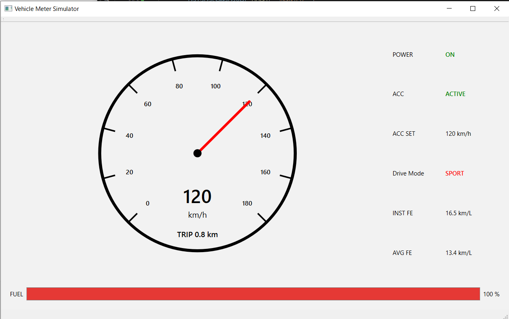
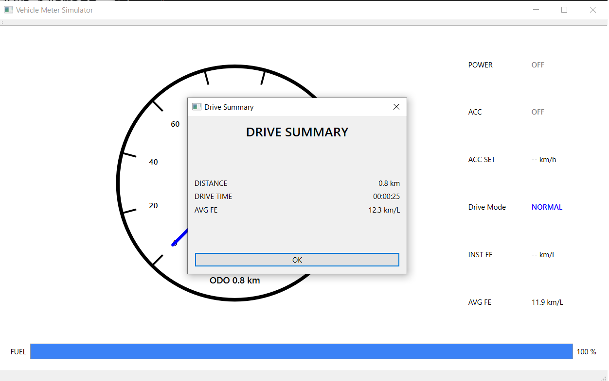
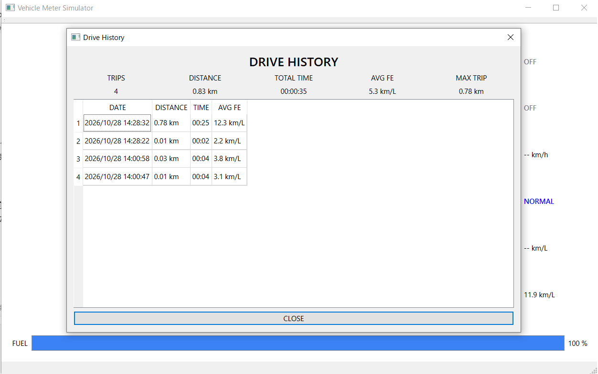

# Vehicle Meter Simulator

C++ / Qt Widgetsで作成した、キーボードで操作できる車載メーターシミュレーターです。加速・減速、燃料消費、定速走行、走行モードの切り替えを再現し、走行結果をSQLiteへ保存して履歴と統計を表示します。

車両の状態・制御ロジック、画面表示、データ保存を分けて実装しています。C++のクラス設計からQtによるGUI、SQLによる保存・集計、GoogleTestによる検証までを扱う学習・ポートフォリオ作品です。実車との通信は行わず、数値は簡易モデルで計算します。

## 主な機能

| 機能 | 内容 |
| --- | --- |
| メーター表示 | アナログ風速度計、燃料残量、電源・ACC・走行モードの状態を表示 |
| 車速・燃料シミュレーション | 加速、ブレーキ、惰性減速、速度上限180 km/h、燃料消費を計算 |
| 定速走行（画面表記：ACC） | 30 km/h以上で現在速度を目標に設定。目標速度を5 km/h刻みに調整し、ブレーキ・電源OFF・燃料切れで解除 |
| Drive Mode | NORMAL → SPORT → ECOの順に切り替え、加速度と画面配色を変更 |
| 距離表示 | ODO、TRIP、今回の電源ON以降の距離（START）を切り替え。TRIPリセットに対応 |
| 燃費表示 | 瞬間燃費と平均燃費を表示。計算できない場合は数値の代わりにハイフンを表示 |
| Drive Summary | Pキーによる電源OFF時に、今回の走行距離・経過時間・平均燃費を表示 |
| SQLite保存 | 開始・終了日時、経過秒数、走行距離、平均燃費を保存 |
| Drive History | 保存順の新しいものから履歴を表示し、走行回数・総距離・総時間・平均燃費・最長距離を集計 |

ACCは設定速度を維持する機能です。先行車の認識や車間距離制御は実装していません。

## 画面

### メーター画面



### Drive Summary



### Drive History



## 使用技術

- C++17
- Qt 6：Core / Gui / Widgets / Sql
- SQLite：Qt SQLのQSQLITEドライバー経由で利用
- CMake / Ninja
- GoogleTest 1.15.2：CMakeのFetchContentで取得

## 構成と役割

```text
リポジトリのルート/
├── README.md
├── .gitignore
├── CMakeLists.txt              # 子フォルダを追加する入口
├── CMakePresets.json           # Qtの共通設定（非表示プリセットのみ）
├── VehicleMeterGuiTest/
│   ├── CMakeLists.txt          # アプリ・ライブラリ・テストの定義
│   ├── qt.cmake
│   ├── main.cpp
│   ├── MainWindow.*            # 入力・更新・表示と保存処理の呼び出し
│   ├── SpeedometerWidget.*     # 速度計の描画
│   ├── VehicleState.*          # 車両状態、ACC、モード
│   ├── VehicleController.*     # 操作に応じた状態更新
│   ├── FuelEconomyCalculator.* # 燃料消費と燃費計算
│   ├── Odometer.*              # 距離の積算
│   ├── Config.h               # シミュレーションの定数
│   ├── InputTypes.h           # 入力データとコマンド
│   ├── DriveRecord.h          # 1回の走行記録
│   ├── DriveStatistics.h      # 集計結果
│   ├── DatabaseManager.*      # SQL実行とデータ変換
│   ├── DriveSummaryDialog.*   # 今回の走行結果の表示
│   ├── DriveHistoryDialog.*   # 履歴・統計の表示
│   └── tests/
│       ├── VehicleCoreTests.cpp
│       ├── DatabaseManagerTests.cpp
│       └── DatabaseManagerTestMain.cpp
└── docs/screenshots/
```

### DB連携

保存時は `MainWindow → DriveRecord → DatabaseManager → SQLite（drive_history）` の順に処理します。履歴表示時は同じDBから `DatabaseManager` が走行記録と `DriveStatistics` を取得し、`DriveHistoryDialog` へ渡します。

- `vehicle_meter.db` は**実行ファイルと同じフォルダ**に作成されます。アプリにはそのフォルダへの書き込み権限が必要です。
- 初回起動時に `CREATE TABLE IF NOT EXISTS` でテーブルを準備し、値をバインドした `INSERT` で保存します。
- 履歴は `ORDER BY id DESC` で取得します。日時での並べ替えではなく、保存IDの降順です。
- `COUNT / SUM / AVG / MAX` で統計を取得します。
- 履歴画面の平均燃費は、NULLを除いた**各走行の平均燃費の単純平均**です。総距離÷総消費燃料による加重平均ではありません。
- 未取得の燃費は `std::optional` とSQLのNULLで扱います。空DBでは件数・距離・時間などは0、平均燃費は未取得として表示します。

## ビルド・実行（Windows / MSVC）

### 必要な環境

- Visual Studioの「C++によるデスクトップ開発」とx64 MSVCツールセット
- MSVC用のQt 6（Core / Gui / Widgets / SqlとQSQLITEプラグインを含む）
- CMake 3.24以上、Ninja
- 初回構成時にGoogleTestを取得できるインターネット接続

`CMakeLists.txt` の宣言上の最小値は3.16ですが、現在の設定は `DOWNLOAD_EXTRACT_TIMESTAMP` を使うため、本手順ではCMake 3.24以上を必要とします。

### 構成とビルド

Visual Studioの **Developer PowerShell** をx64環境で開き、親の `CMakeLists.txt` があるリポジトリのルートへ移動してください。以下のQtパスはインストール先に合わせて変更します。MSVC用QtとMSVCコンパイラを組み合わせてください。

```powershell
$env:QTDIR = 'C:\Qt\6.12.0\msvc2022_64'
$env:PATH = "$env:QTDIR\bin;$env:PATH"
$env:QT_PLUGIN_PATH = "$env:QTDIR\plugins"

cmake -S . -B out/build/debug -G Ninja -DCMAKE_BUILD_TYPE=Debug "-DCMAKE_PREFIX_PATH=$env:QTDIR"
cmake --build out/build/debug --parallel
```

各コマンドが成功してから次へ進みます。`QTDIR` は構成前に設定してください。DBテスト用のQtパスも構成時に設定されます。

共有の `CMakePresets.json` には非表示の共通プリセットのみがあり、そのまま実行できる `Debug-x64` は含まれません。上記のコマンドは個人用 `CMakeUserPresets.json` に依存しません。

### 起動

同じPowerShellで実行します。

```powershell
& './out/build/debug/VehicleMeterGuiTest/VehicleMeterGuiVer2.exe'
```

QtのDLLが見つからない場合は `QTDIR` と `PATH`、`QSQLITE driver not loaded` が出る場合は `QT_PLUGIN_PATH` とQtの `plugins/sqldrivers` を確認してください。上記はQtをインストールした開発環境での起動手順です。

## 操作方法

メイン画面を選択して操作します。

| キー | 操作 |
| --- | --- |
| `P` | 電源ON / OFF。ON→OFFで保存処理を行い、Drive Summaryを表示 |
| `W` / `↑` | 押している間、加速 |
| `S` / `↓` | 押している間、ブレーキ。ACCも解除 |
| `C` | ACC開始 / 解除。開始には電源ON・燃料あり・30 km/h以上が必要 |
| `+` / `-` | ACC中の目標速度を調整（範囲30～180 km/h） |
| `M` | 電源ON中にNORMAL → SPORT → ECOを切り替え |
| `T` | 電源ON中にODO → TRIP → STARTを切り替え |
| `F` | TRIPをリセット |
| `R` | 車両状態と燃費計算を初期化。ODO / TRIPや保存済みDBは消去しない |
| `H` | 電源OFF中にDrive Historyを開く |
| `Q` | アプリを終了 |

試す場合は、`P`でON → `W`で加速 → 30 km/h以上で`C` → `W`を離して定速走行 → `P`でOFF → Summaryを閉じて`H`、の順に操作します。

### 現在の仕様・制約

- 走行記録の保存契機はPキーによる電源ON→OFFです。終了ボタン・Qキー・Rキーによる終了／リセットでは、その走行は保存されません。
- 経過時間は電源ON中の更新間隔の積算です。停車中も含まれ、開始・終了日時の差そのものではありません。
- ODO / TRIPはアプリ実行中の値で、再起動時にDBから復元しません。保存済み履歴は再起動後も読み込めます。
- 履歴画面に検索・編集・削除機能はありません。
- DBエラーはログへ出力します。保存結果を確認する画面通知は未実装で、保存に失敗してもSummaryは表示されます。

## テスト

ビルド後、同じPowerShellで実行します。

```powershell
# すべての登録テスト
ctest --test-dir out/build/debug --output-on-failure

# 車両ロジックを個別に実行（36ケース）
& './out/build/debug/VehicleMeterGuiTest/VehicleMeterCoreTests.exe'

# DB処理を個別に実行（7ケース）
& './out/build/debug/VehicleMeterGuiTest/DatabaseManagerTests.exe'
```

| 対象 | 検証内容 |
| --- | --- |
| 車両状態・制御 | 初期状態、電源OFF時の入力、速度・燃料の上下限、ブレーキ、リセット、燃料切れ |
| ACC | 開始条件、速度維持・復帰、解除条件、目標速度の丸め・上下限 |
| Drive Mode | 初期モード、切り替え順、電源OFF時の挙動、モード別加速度 |
| 燃費 | 距離・消費燃料・平均燃費の計算、電源OFF時の瞬間燃費 |
| DB | 空DBの履歴・集計、1件保存と読み出し、NULL燃費、保存ID降順、NULLを含む集計、テーブル未作成時の保存失敗 |

DBテストはSQLiteの `:memory:` を使い、実際の `vehicle_meter.db` を変更しません。GoogleTestのケース数は合計43件です。CTestでは車両ロジック36件とDB実行ファイル1件として登録されるため、合計37件と表示されます。画面操作や描画を確認するGUI自動テストは含みません。
